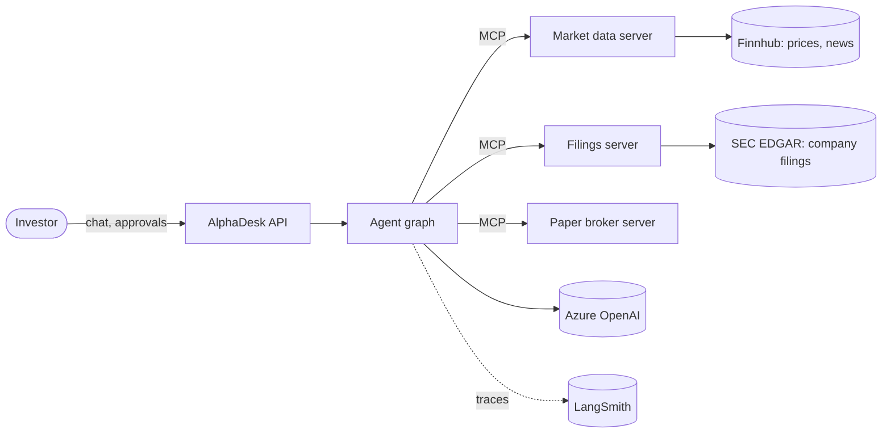
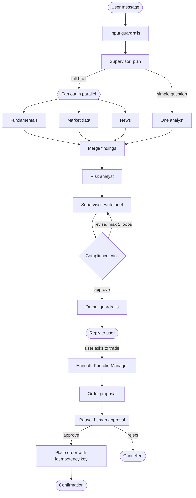

# AlphaDesk — Architecture

Status: v0.3, approved 10 Nov 2026. Decisions are recorded in `docs/adr/`. · 10 Nov 2026 · Owner: Naveen Manjappa

AlphaDesk is an AI investment research desk. A team of agents researches US-listed companies, writes cited briefs, and runs a paper-trading portfolio. Every trade needs human approval. All money is simulated and in USD.

This doc describes the finished system. It is built in phases, so each section says which phase adds it.

---

## 1. The 60-second explanation

> AlphaDesk works like a small investment firm. A supervisor takes the question and sends it to specialist analysts. They work in parallel: one reads SEC filings, one pulls market data, one scans news. A risk analyst checks the user's portfolio using plain code, not the LLM. A critic reviews the draft and can send it back. If the user wants to trade, the work is handed to a portfolio manager agent. That agent can only propose an order. A human approves it, plain code places it, and an idempotency key makes sure it runs exactly once. Tools sit behind MCP servers, state is checkpointed to Postgres, and every run is traced and evaluated.

## 2. Scope

**In scope**

- Question answering and full research briefs on US-listed companies.
- A watchlist with a scheduled daily brief.
- A paper portfolio in USD, with buy and sell orders at real prices.
- Human approval on every order.

**Out of scope**

- Real money or a real broker.
- Personal financial advice. Output is research, and says so.
- Currency conversion. Everything is USD.
- Options, crypto, or non-US markets.

## 3. System context



**SEC EDGAR** is the US regulator's free public database of company filings. Every US-listed company must file there. AlphaDesk reads annual reports (10-K), quarterly reports (10-Q) and event notices (8-K) from it. It needs no API key, and it also publishes key financial figures as structured data.

## 4. Layers

| Layer | What it holds | Technology |
|---|---|---|
| Interface | Streaming chat, approval inbox, portfolio view | FastAPI, plain web page |
| Orchestration | Supervisor graph, routing, handoffs | LangGraph |
| Agents | Supervisor plus six specialists (section 5) | LangChain `create_agent` + middleware |
| Tools | Three MCP servers (section 7) | FastMCP servers, LangChain MCP client |
| Knowledge | Filing chunks and embeddings | Qdrant |
| State and memory | Thread state, long-term memory, portfolio, audit | Postgres |
| Cache | Tool results, repeated answers | Redis |
| Trust | Guardrails, evals, tracing | NeMo Guardrails, rule checks in code, DeepEval, LangSmith |
| Platform | Containers, CI, hosting | Docker Compose locally, GitHub Actions, Azure Container Apps (optional) |

## 5. The agents

Each agent has one job, a small tool set, and a typed output (a Pydantic model). Agents never pass free text to each other.

| Agent | Job | Tools | Model tier | Output |
|---|---|---|---|---|
| Supervisor | Understand the request, pick analysts, merge results | None (routing only) | Small | `Plan`, then final `Brief` |
| Fundamentals Analyst | Read 10-K and 10-Q filings | Filings server (read) | Large | `FundamentalsFinding` with citations |
| Market Data Analyst | Price, valuation ratios, earnings dates | Market data server (read) | Small | `MarketSnapshot` |
| News Analyst | Recent news and its likely impact | Market data server: company news (read) | Small | `NewsFinding` with sources |
| Risk Analyst | Portfolio exposure and concentration | Broker server (read), calculator code | Small | `RiskAssessment` |
| Compliance Critic | Check the draft: grounded, cited, not advice | None | Large | `Review` (approve or revise with reasons) |
| Portfolio Manager | Turn a user's trade request into an order proposal | Broker server (read) | Small | `OrderProposal` |

Rules that hold across agents:

- **Numbers come from tools, not the LLM.** Ratios, exposure and totals are calculated in code.
- **No agent can write.** Every agent has read-only tools. The Portfolio Manager only proposes an order. After human approval, a plain code node places it (ADR 009).
- **Two model tiers.** A small, cheap model for routing and extraction. A large model for analysis and critique.

## 6. How a request flows



Patterns used, and where:

| Pattern | Where in the flow |
|---|---|
| Router | Supervisor chooses "one analyst" or "full brief" |
| Supervisor (orchestrator-worker) | Supervisor plans, analysts execute |
| Parallel fan-out and fan-in | Three analysts run at once, results merged |
| Evaluator-optimizer | Critic sends the draft back, capped at two loops |
| Handoff | Control moves from research to the Portfolio Manager |
| Human-in-the-loop | Graph pauses on the order until the user decides |
| Subgraph | Fundamentals Analyst is its own graph with retrieval steps |

## 7. MCP servers

Tools start as plain Python functions in Phase 1. Phase 2 moves them behind MCP servers.

| Server | Tools it exposes | Access |
|---|---|---|
| `market-data` | `get_quote`, `get_ratios`, `get_earnings_date`, `get_price_history`, `get_company_news` | Read-only, all analysts |
| `filings` | `search_filings`, `get_filing_section`, `list_filings` | Read-only, Fundamentals Analyst |
| `paper-broker` | `get_portfolio`, `get_order`, `place_order`, `cancel_order` | Read for Risk Analyst and Portfolio Manager. Write tools are called only by the execution node, never by an LLM. |

Why MCP here:

- **Decoupling.** Each server runs as its own service. Swap the market data provider without touching agents.
- **Reuse.** The same servers work from any MCP client, such as Claude Desktop.
- **Access control.** Each agent is given only the tools it needs.

Data sources behind the servers:

- **Prices, earnings dates and news:** Finnhub's free tier is the leading choice. Quotes may be delayed, which is fine for paper trading. Every quote shows its timestamp.
- **Ratios:** calculated in code from the price plus figures from SEC EDGAR.
- **Filings:** SEC EDGAR.

The cost: an extra network hop and more services to run. For a small app, plain functions are simpler. That trade-off gets its own ADR.

## 8. State and memory

| Type | What it holds | Where | Scope | Phase |
|---|---|---|---|---|
| Graph state | Messages, plan, findings, draft, review count | LangGraph checkpointer on Postgres | One thread | 1 |
| Conversation history | Recent turns, older turns summarised | Inside graph state | One thread | 1, 4 |
| Semantic memory | User profile: risk appetite, horizon, exclusions, watchlist | LangGraph store on Postgres | One user, all threads | 4 |
| Episodic memory | Past briefs and trade decisions, with the reasons | LangGraph store on Postgres | One user, all threads | 4 |
| Procedural memory | Learned instructions, such as "always show P/E first" | LangGraph store on Postgres | One user, all threads | 4 |

The key distinction:

- **Checkpointer = short-term.** It saves the graph's state after every step, per thread. It gives conversation continuity, pause and resume, replay, and crash recovery.
- **Store = long-term.** It holds facts that outlive a thread, keyed by user.

Context rules:

- Each analyst sees the task and its own tool results. It does not see other analysts' raw output.
- The Supervisor sees typed findings, not raw tool dumps.
- Old turns are summarised once the history passes a token budget.

## 9. Caching

| Cache | What | Lifetime | Why |
|---|---|---|---|
| Prompt cache | Stable system prompts and tool definitions | Provider-managed | Cuts cost and latency on every call |
| Tool-result cache | Quotes, ratios, filing sections | Quotes: minutes. Filings: days. | Avoids repeat API calls |
| Semantic cache | Answers to near-identical research questions | Until new filing or price data | Skips a full run |

What is never cached: portfolio state, order status, anything user-specific in a shared key. Stale data here would be a correctness bug, not a slow page.

## 10. Reliability

**Idempotency.** Each order proposal gets a unique key when it is created. The broker stores the key with a unique constraint. A repeat call with the same key returns the original order instead of creating a new one. This matters because a paused graph node runs again from its start when resumed, and retries can repeat a call.

**Durable execution.** State is checkpointed after every step. If the process dies mid-run, the graph resumes from the last checkpoint on the same thread.

**Failure handling.**

| Failure | Response |
|---|---|
| Tool timeout or error | Bounded retries with backoff, then a typed error to the Supervisor |
| One analyst fails | Brief continues and states what is missing |
| Model outage or rate limit | Fall back to a second model deployment |
| Critic keeps rejecting | Stop after two loops, return the draft with open issues listed |
| Runaway loop | Hard cap on steps and on spend per run |

## 11. Guardrails

Three layers. Each catches what the others miss.

| Layer | Checks | How |
|---|---|---|
| Input | Jailbreak and prompt injection attempts, off-topic requests, personal data | NeMo Guardrails input rails |
| Tool | Least-privilege tool sets, schema validation on arguments, order size limits, approval on writes | Plain code. These are business rules and must be deterministic. |
| Output | Every number traceable to a tool result, every claim cited, research framing rather than advice | Plain code for numbers and citations, plus the Compliance Critic |

The split: a framework where the problem is generic, code where the rule is specific to this domain. "No order above the cash balance" is an `if` statement, not a model's judgement.

Retrieved content (news, filings) is treated as data, never as instructions. This is the main prompt-injection route in a research app.

## 12. Observability and evals

**Tracing (from Phase 1).** Every run is traced in LangSmith: each agent step, tool call, token count, cost and latency.

**Audit trail (Phase 5).** A Postgres table records each order: who proposed it, the evidence, who approved it, and when.

**Evals (seeded in Phase 1, hardened in Phase 6).**

| Eval type | Question it answers | Example |
|---|---|---|
| Final answer | Is the output right and grounded? | Revenue figure matches the 10-K |
| Trajectory | Did it take a sensible path? | A valuation question called the market data tool |
| Per-agent | Does one agent do its job alone? | Critic catches an uncited number |
| Safety | Do guardrails hold? | Injected instruction in a news article is ignored |

Tools:

- **LangSmith** for tracing, debugging, and cost and latency per run.
- **DeepEval** for the eval test suite. It runs under pytest, so a failed metric fails the build.
- **Exact checks in plain code** wherever a right answer exists. LLM-judged scores can vary between runs, so they are not enough alone for finance.

| Exact check (code) | Judged check (DeepEval) |
|---|---|
| Revenue in the brief equals the figure in the filing | Is the brief faithful to the retrieved text? |
| Every number traces to a tool result | Did the run complete the user's task? |
| A valuation question called the market data tool | Did the agents follow a sensible plan? |
| An order above the cash balance is refused | Is the answer relevant to the question? |

A small golden dataset runs in CI. A drop in scores blocks the merge.

## 13. Data stores

| Store | Holds |
|---|---|
| Postgres | Checkpoints, long-term memory, portfolio, orders, audit log |
| Qdrant | Filing chunks and embeddings |
| Redis | Tool-result and semantic caches |

Filings pipeline: download from SEC EDGAR, parse, split into chunks that keep tables intact, embed, store in Qdrant with metadata (ticker, form type, period, section).

## 14. API surface

| Endpoint | Purpose |
|---|---|
| `POST /chat` | Send a message. Streams progress and the answer. |
| `GET /threads/{id}` | Conversation history |
| `GET /approvals` | Orders waiting for a decision |
| `POST /approvals/{id}` | Approve or reject an order |
| `GET /portfolio` | Holdings, cash and performance |
| `GET /health` | Liveness and dependency checks |

Until Phase 7 there is one demo user. Real authentication comes with deployment.

## 15. Repository layout

```
alpha-desk/
  CodingStandards.md
  docker-compose.yml
  Makefile
  CLAUDE.md
  docs/
    architecture.md
    project-rules.md
    adr/
    phases/
  src/alphadesk/
    api/            # FastAPI routes, thin
    graph/          # supervisor graph, state, routing
    agents/         # one module per agent
    prompts/        # prompt text, versioned
    tools/          # tool wrappers and MCP client
    memory/         # store access, summarisation
    guardrails/
    domain/         # Pydantic models: Brief, OrderProposal, ...
    services/       # portfolio maths, risk calculations
    integrations/   # clients for outside APIs: Finnhub, SEC EDGAR
    config/
  mcp_servers/
    market_data/
    filings/
    paper_broker/
  evals/
  tests/
```

## 16. Running it, and cost

Goal: no running cost apart from LLM calls.

**Local first.** The whole system runs on a laptop with one command, `docker compose up`. That starts the API, the three MCP servers, Postgres, Qdrant and Redis. This is the main way to develop and to demo. It costs nothing.

**Cloud deploy is optional (Phase 7).** It uses free tiers, checked on 10 Nov 2026:

| Piece | Free option | Limits to know |
|---|---|---|
| API and MCP servers | Azure Container Apps, scale to zero | Monthly free grant of 180,000 vCPU-seconds, 360,000 GiB-seconds and 2 million requests. Set minimum replicas to 0. First request after idle is slow. |
| Postgres | Neon free plan | No card, no time limit. Compute sleeps when idle and wakes on the next query. Small storage allowance. |
| Qdrant | Qdrant Cloud free cluster | One node, 0.5 vCPU, 1 GB RAM, 4 GB disk. Pauses after seven idle days and needs a manual resume. A keep-alive job prevents this (see below). |
| Redis | Upstash free plan | 256 MB and 500,000 commands a month. |
| Tracing | LangSmith free plan | Sample traces if volume grows. |

These three providers are the chosen ones: Neon, Qdrant Cloud and Upstash.

**Qdrant keep-alive.** A scheduled GitHub Actions workflow sends one small read request to the Qdrant cluster every two days. That counts as activity, so the cluster does not pause before a demo.

- The cluster URL and API key are stored as GitHub Actions secrets, never in the repo.
- The request is read-only, for example listing collections.
- The workflow fails loudly if the cluster does not answer, so a pause is noticed early.
- It can also be run by hand before a demo.
- GitHub switches off scheduled workflows in a repo with no activity for 60 days. Regular commits avoid that, and it can be re-enabled with one click.
- Built in Phase 7, when the cluster exists.

Design choices that keep the app inside these limits:

- **A fixed company list.** About 20 well-known US companies, with recent filings only. That keeps the vector store far below 1 GB.
- **Caching.** Fewer market data calls and fewer LLM calls.
- **A spend cap per run** on LLM usage.
- **A budget alert** in Azure.

Free tiers change. Recheck each one on the provider's own pricing page before deploying.

## 17. Build phases

| Phase | Adds | Working result |
|---|---|---|
| 1. Single agent | One agent, plain tools, typed output, streaming, history, checkpointer, tracing, first evals | Ask about a company, get a cited answer |
| 2. Knowledge and MCP | Filings pipeline, three MCP servers | Answers grounded in filings and live prices |
| 3. Research desk | Supervisor, parallel analysts, critic loop, plain chat page | A full brief from one question |
| 4. Memory and cache | Long-term store, summarisation, three caches | Remembers the investor, costs less per run |
| 5. Actions | Paper broker writes, handoff, approval, idempotency, crash recovery, audit | Approve a trade, portfolio updates safely |
| 6. Trust layer | NeMo input rails, full rule checks, DeepEval suite, CI gate, dashboards | A quality report with real numbers |
| 7. Cloud deploy (optional) | Azure deploy on free tiers, auth, rate limits, scheduled briefs, load test | A live URL and a demo script |

Phases 1 to 5 are the core. Phase 6 adds depth. Phase 7 is optional: the app is complete and demonstrable locally without it.

## 18. Decisions to record as ADRs

| # | Decision | Leaning |
|---|---|---|
| 001 | Orchestration framework | LangGraph |
| 002 | Supervisor pattern versus peer-to-peer swarm | Supervisor, with one handoff |
| 003 | Plain function tools versus MCP | Functions first, MCP from Phase 2 |
| 004 | LLM provider and model tiers | Azure OpenAI, two tiers |
| 005 | Postgres for state, memory and business data | One database |
| 006 | Vector store | Qdrant |
| 007 | Market data provider | Finnhub free tier, behind the MCP server |
| 008 | Tracing and evals tooling | LangSmith for tracing, DeepEval plus code checks for evals |
| 009 | Approval via middleware versus a custom interrupt node | Custom node. The LLM proposes, code executes. |
| 010 | Idempotency key design | Key on the proposal, enforced by the broker |
| 011 | Cache store and invalidation | Redis, time-based plus data-date keys |
| 012 | Guardrail tooling | NeMo Guardrails for input, code for tool and output layers |
| 013 | Local-first running and cloud hosting | Docker Compose first. Optional deploy on Neon, Qdrant Cloud and Upstash, with a Qdrant keep-alive job. |

## 19. Verified against current docs

Checked against the LangChain documentation on 10 Nov 2026:

- Agents are built with `create_agent` plus middleware. Human approval has built-in middleware.
- Checkpointer is thread-scoped short-term memory. Store is cross-thread long-term memory. Both have Postgres implementations.
- Handoffs between agent subgraphs use `Command` with `graph=Command.PARENT`.
- MCP client support now lives in `langchain.mcp` (`MCPAdapter`), built on FastMCP. It replaced the separate `langchain-mcp-adapters` package in LangChain 1.4.0 and is marked beta, so its API may change.

Checked on the web on 10 Nov 2026 (secondary sources for some figures):

- DeepEval has a LangGraph integration and runs under pytest.
- NeMo Guardrails supports LangGraph and tool calling, and runs on Python 3.10 to 3.13.
- Free-tier limits in section 16.

Still to confirm at setup: Python 3.13 support across all libraries, exact package versions, Finnhub's current free-tier terms, and each hosting free tier on the provider's own page.
