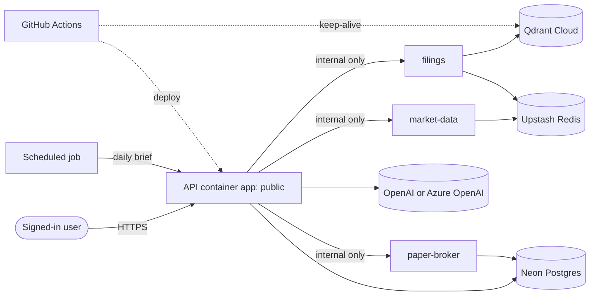

# Phase 7 Spec: Cloud Deploy (optional)

Status: draft · 16 Nov 2026 · Review against your Phase 6 notes before building

This phase is optional. AlphaDesk is complete and demonstrable locally without it.

## Goal

Put AlphaDesk on a live URL, on free tiers, with real sign-in. It costs nothing when idle, apart from LLM calls.

**Working result:** you open a URL, sign in, and get a brief. A second user signs in and sees only their own threads, memory and portfolio. Each morning a brief for every company on your watchlist is waiting. When nobody uses the app, nothing is running and nothing is billed.

## What you will be able to explain after this phase

- How a container image is built to be small and safe.
- What "scale to zero" means, what it saves, and what it costs in cold starts.
- How one codebase runs locally and in the cloud with only settings changed.
- How sign-in works with tokens, and where the API checks them.
- How to keep one user's data away from another's.
- Why an LLM app needs rate limits and spend limits per user.
- How a deploy pipeline works without storing long-lived cloud passwords.
- How to load test an LLM app without a large bill.

## Not in this phase

| Left out | Why |
|---|---|
| A custom domain, a CDN | Not needed for a demo |
| Multiple regions, high availability | Beyond a free-tier personal project |
| A richer frontend | A separate piece of work, if wanted |
| Real money or a real broker | Out of scope for the project |

If Claude Code starts building any of these, stop it.

## Before you start

- Phase 6 exit checklist is complete and tag `v0.6-phase6` exists.
- Read your `phase-6-notes.md`. If an open question changes this spec, update the spec first.
- An Azure subscription. Know whether you have Azure OpenAI access. Slice 7 needs it and can be skipped without it.
- Free accounts on Neon, Qdrant Cloud and Upstash.
- The Azure CLI installed.
- **Recheck every free tier on the provider's own pricing page.** The limits in the architecture doc were checked on 10 Nov 2026 and will have changed. This is Slice 0.

## How to work through this spec

There are 14 slices. Each adds **one concept**. Same routine as before:

1. Read the slice. Understand the concept before any code exists.
2. Give Claude Code the prompt in the slice.
3. Read every line it wrote.
4. Run the "Done when" checks yourself.
5. Answer the "Explain back" questions out loud, without looking at the code.
6. Commit. One slice, one commit.

Two extra rules for this phase:

- **You run the cloud commands.** Claude Code writes the files and tells you the command. You run it and read the output. Nothing that creates or deletes a cloud resource runs without you.
- **Set the budget alert first.** Slice 0 does this before any resource exists.

## The target

| Piece | Where | Setting that matters |
|---|---|---|
| API | Azure Container Apps, public ingress | Minimum replicas 0 |
| Three MCP servers | Azure Container Apps, internal ingress | Minimum replicas 0, not reachable from the internet |
| Postgres | Neon free plan | Sleeps when idle |
| Qdrant | Qdrant Cloud free cluster | Pauses after seven idle days |
| Redis | Upstash free plan | Monthly command limit |
| Images | GitHub Container Registry | Free for public repos |

Local and cloud use the same images and the same setting names. Only the values differ.

## Decisions to record in this phase

| ADR | Decision | Leaning |
|---|---|---|
| 025 | Sign-in provider | Microsoft Entra ID. It fits an Azure deploy and is free at this size. The API only validates a token, so the provider can change. |
| 026 | How cloud resources are defined | Bicep files in the repo, so the environment can be rebuilt and torn down with one command |
| 027 | What triggers the daily brief | A Container Apps scheduled job. A GitHub Actions schedule is the fallback. |

---

## Slice 0: Recheck, plan and set a budget

**Concept:** cost is a design input. Know the limits before you build inside them.

**Build**

- `docs/deploy-plan.md`: each provider, its current free limits, the date you checked, and the link.
- An estimate of how AlphaDesk's usage compares with each limit.
- An Azure resource group for the project, and a budget alert on it at a small amount.
- ADR 013 updated if any limit has changed in a way that matters.

**Done when**

- Every free tier in the plan has today's date and a source link.
- The budget alert exists and has sent a test notification.
- You have a written answer to "what happens if a free tier is withdrawn?" for each piece.

**Prompt for Claude Code**

> Help me with Slice 0 of docs/phases/phase-7-spec.md. Read docs/adr/013-running-and-hosting.md. Draft docs/deploy-plan.md as a table for me to fill in from each provider's pricing page. Give me the Azure CLI commands for a resource group and a budget alert. I will run them.

**Explain back**

- Which free tier is the tightest for this app?
- What does the budget alert do, and what does it not do?

---

## Slice 1: Production images

**Concept:** a production image is small, runs as a non-root user, and takes all its config from the environment.

**Build**

- A multi-stage Dockerfile for the API and one for the MCP servers: a build stage with `uv`, a slim runtime stage.
- A non-root user. No secrets, no `.env`, no test files in the image.
- A `.dockerignore`.
- A health check in each image.
- Docker Compose switched to build from these same Dockerfiles.

**Done when**

- `docker compose up` still runs the whole system from the new images.
- No secret appears in any image layer. You checked the image history.
- The process inside the container is not root.
- You know each image's size.

**Prompt for Claude Code**

> Build Slice 1 of docs/phases/phase-7-spec.md. Check the current uv docs for Docker builds. Multi-stage, non-root, no secrets in layers. Local Compose must use the same Dockerfiles.

**Explain back**

- What does the build stage have that the runtime stage does not?
- Why run as non-root?
- Why does the same image run locally and in the cloud?

---

## Slice 2: Hosted data stores

**Concept:** managed services. The same code, pointed at a database you do not run.

**Build**

- A Neon project, a Qdrant Cloud cluster and an Upstash database, created by you.
- A cloud settings profile: connection values only, supplied as environment variables.
- TLS on every connection.
- Neon's pooled connection string for the app. Check that the checkpointer works through the pooler.
- `make migrate` and `make ingest` run against the hosted stores from your laptop.
- A clean-up job for old checkpoints, so storage stays inside Neon's allowance (ADR 005).

**Done when**

- The local API, pointed at the three hosted stores, passes the demo script.
- The first request after Neon has slept succeeds, slowly. You measured the wake-up time.
- The Qdrant collection size is well under the free cluster's limit.
- No connection string is in the repo.

**Prompt for Claude Code**

> Build Slice 2 of docs/phases/phase-7-spec.md. Check the current Neon docs on pooled connections and prepared statements, and the LangGraph Postgres checkpointer docs. No code change should be needed beyond settings and the clean-up job. Tell me if one is.

**Explain back**

- Why use a pooled connection with a database that sleeps?
- What does the user experience when Neon wakes up, and how does the app handle it?
- Why do old checkpoints need cleaning up?

---

## Slice 3: Deploy to Azure Container Apps

**Concept:** infrastructure as code. The environment is a file you can review, rebuild and delete.

**Build**

- Bicep files for: a Container Apps environment, the API app with public ingress, and three MCP server apps with internal ingress. ADR 026 written.
- Minimum replicas 0 and a low maximum on every app.
- Secrets held as Container Apps secrets and passed as environment variables.
- Images pushed to GitHub Container Registry.
- One command to deploy, and one to tear everything down.

**Done when**

- `/health` answers on the public URL and reports all dependencies.
- The MCP servers cannot be reached from the internet. You tried.
- After 15 idle minutes, the replica count is zero.
- You tore the environment down and rebuilt it from the files.

**Prompt for Claude Code**

> Build Slice 3 of docs/phases/phase-7-spec.md. Check the current Azure Container Apps docs for Bicep, internal ingress and scale-to-zero. Write the files and give me the commands. I will run every command that creates or deletes a resource.

**Explain back**

- What happens, step by step, on the first request after everything has scaled to zero?
- Why are the MCP servers internal only?
- What does tearing down and rebuilding prove?

---

## Slice 4: Sign-in

**Concept:** authentication. The API learns who is calling from a signed token, and trusts nothing else.

**Build**

- An app registration with the sign-in provider. ADR 025 written.
- Sign-in on the page, using the provider's standard browser flow.
- A FastAPI dependency that validates the token on every request: signature, issuer, audience, expiry.
- The `user_id` now comes from the token. The demo user setting is used only when running locally with auth switched off.
- `/health` stays open. Everything else needs a valid token.

**Done when**

- A request with no token gets 401.
- A request with an expired or tampered token gets 401.
- A signed-in user gets a brief.
- Unit tests use locally signed test tokens and need no network.

**Prompt for Claude Code**

> Build Slice 4 of docs/phases/phase-7-spec.md. Check the provider's current docs for validating access tokens in an API and for the browser sign-in flow. Token validation is one dependency used by all routes. Ask before adding a dependency.

**Explain back**

- What four things does the API check on a token?
- Why does the API never see a password?
- Where does `user_id` come from now, and why can the user not fake it?

---

## Slice 5: Keep users apart

**Concept:** authorisation. Knowing who you are is not the same as being allowed to see something.

**Build**

- Every thread, proposal, order, portfolio and memory item is owned by a user ID.
- Every read and write checks ownership, in the repository or service layer, not only in the route.
- A new user gets their own demo portfolio with 100,000 USD on first sign-in.
- The MCP servers accept calls only from the API, using a shared service token.
- The approver recorded in the audit trail is now the signed-in user.

**Done when**

- User B asking for user A's thread ID gets 404.
- User B cannot approve user A's proposal.
- User B's brief shows nothing from user A's memory or portfolio.
- These are automated tests with two test users.
- The semantic cache still serves only non-personal briefs.

**Prompt for Claude Code**

> Build Slice 5 of docs/phases/phase-7-spec.md. Ownership checks live below the route layer so they cannot be skipped. Write the two-user tests first, for threads, approvals, portfolio and memory.

**Explain back**

- What is the difference between authentication and authorisation?
- Why return 404 and not 403 for someone else's thread?
- Why check ownership below the route?

---

## Slice 6: Rate limits and spend limits

**Concept:** protect the budget. On a public URL, every request can cost money.

**Build**

- A request limit per user per minute, counted in Redis.
- A daily LLM spend limit per user, using the per-run cost already logged.
- A global daily spend limit for the whole app, as a last line.
- A 429 response with a clear message and the time to try again.
- A sign-up allow-list in settings, so only invited accounts can use the deployed app.

**Done when**

- The request after the limit gets 429, and the next minute it works.
- A user over their daily spend is told so, and no model is called.
- An account not on the allow-list is refused after sign-in.
- If Redis is down, the limiter fails closed for the spend limit. Decide this on purpose and write down why.

**Prompt for Claude Code**

> Build Slice 6 of docs/phases/phase-7-spec.md. Limits are settings. Write the tests first with a fake clock. Explain fail-open against fail-closed for each limit and let me choose.

**Explain back**

- Why limit spend as well as requests?
- The cache fails open and the spend limit fails closed. Why the difference?
- What is the allow-list protecting?

---

## Slice 7: Run on Azure OpenAI

**Concept:** the provider is a setting. Prove it, with the evals as the judge.

Skip this slice if you have no Azure OpenAI access. Note that in ADR 014.

**Build**

- An Azure OpenAI resource with one deployment per tier.
- The deployed app's provider setting switched to `azure_openai`.
- The full eval set run against it, using the Phase 6 model-change routine.
- The guardrail base layer reading Azure's content filter result.

**Done when**

- A brief works end to end on Azure OpenAI with no code change.
- The eval comparison is saved, and you made an accept or refuse decision.
- ADR 014 is updated: Azure OpenAI is now supported by test.

**Prompt for Claude Code**

> Help me with Slice 7 of docs/phases/phase-7-spec.md. Read docs/adr/014-openai-default-provider.md. This should be settings only. If any code must change, stop and tell me why before changing it.

**Explain back**

- What changed between the two providers, and what did not?
- Why do the evals decide, and not a quick manual try?

---

## Slice 8: The deploy pipeline

**Concept:** continuous delivery. A tagged commit reaches the cloud the same way every time.

**Build**

- A GitHub Actions workflow triggered by a version tag: build images, push them, deploy, then run a smoke test.
- Sign-in to Azure through OpenID Connect federation. No long-lived cloud secret is stored in GitHub.
- It runs only if the Phase 6 CI gate passed on that commit.
- The smoke test: `/health`, then one signed-in simple question.
- A documented rollback: redeploy the previous image tag.

**Done when**

- Pushing a tag deploys a new revision with no manual step.
- A deliberately broken image fails the smoke test, and you rolled back.
- No cloud password or key for Azure is stored in the repo's secrets.

**Prompt for Claude Code**

> Build Slice 8 of docs/phases/phase-7-spec.md. Check the current GitHub and Azure docs for OIDC federated credentials. The deploy job depends on the check and eval jobs. Include a rollback command in the README.

**Explain back**

- Why is OIDC federation safer than a stored secret?
- What does the smoke test prove, and what does it not?
- How do you roll back?

---

## Slice 9: The scheduled daily brief

**Concept:** an agent that runs without a user. Scheduled work must be safe to run twice.

**Build**

- A scheduled job that runs each weekday morning. ADR 027 written.
- For each user with a watchlist: one brief per ticker, capped at a small number per user.
- An idempotency key of user, ticker and date. A second run on the same day creates nothing new.
- Briefs are stored as episodes and shown on the page under "Today's briefs".
- The job respects the per-user and global spend limits.
- The job never creates a trade proposal.

**Done when**

- A manual trigger produces briefs for your watchlist.
- Triggering it twice produces no duplicates and no second LLM bill.
- With the spend limit reached, the job stops cleanly and logs why.
- A test asserts the scheduled path cannot reach the Portfolio Manager.

**Prompt for Claude Code**

> Build Slice 9 of docs/phases/phase-7-spec.md. Check the current Azure Container Apps docs for scheduled jobs. Reuse the graph and the idempotency idea from Phase 5. The job must not be able to start a trade flow.

**Explain back**

- Why does a scheduled job need idempotency?
- Why must this path never propose a trade?
- What stops a long watchlist from spending the whole budget?

---

## Slice 10: The Qdrant keep-alive

**Concept:** know your platform's idle rules, and automate around them.

**Build**

- A scheduled GitHub Actions workflow, every two days, as described in the architecture doc, section 16.
- One read-only request that lists collections.
- The cluster URL and key as Actions secrets.
- The workflow fails loudly if the cluster does not answer.
- A manual trigger, for use before a demo.

**Done when**

- A manual run succeeds and shows in Qdrant's activity.
- With a wrong URL, the run fails and you are notified.
- You rechecked Qdrant's free-tier terms on keep-alive requests.

**Prompt for Claude Code**

> Build Slice 10 of docs/phases/phase-7-spec.md. Read docs/architecture.md section 16. One small workflow. Read-only request. Secrets never printed.

**Explain back**

- Why every two days and not every six?
- What other thing can silently switch this workflow off?

---

## Slice 11: Watching it in the cloud

**Concept:** operations. A deployed system needs someone, or something, to notice when it breaks.

**Build**

- Container logs in structured form, with a request ID and user ID on every line, and no secrets or personal data.
- A few saved log queries: errors in the last day, slowest requests, cold starts.
- An alert on error rate, and the existing budget alert.
- LangSmith trace sampling set so the free plan is not exceeded.
- A short `docs/runbook.md`: what to check when it is down, slow or over budget.

**Done when**

- You can follow one request from the page, through the API logs, to its LangSmith trace.
- A forced error produces an alert.
- The runbook has been used once, on a problem you caused on purpose.

**Prompt for Claude Code**

> Build Slice 11 of docs/phases/phase-7-spec.md. Structured logs with a request ID that also appears in the trace metadata. Draft the runbook as short checklists for me to edit.

**Explain back**

- How do you find the trace for one user's complaint?
- Why sample traces?
- What is the first thing you check when the app is slow?

---

## Slice 12: A load test

**Concept:** find the limit before a user does, without paying for a thousand LLM calls.

**Build**

- A load test script with a small number of simulated signed-in users.
- A test setting on a separate deployed revision that swaps the model for a fake with realistic delays. Everything else is real.
- Three runs: a cold start from zero, a steady load, and a short spike.
- One small run with the real model, to check the fake's numbers are believable.
- A results section in the quality report.

**Done when**

- You know the cold-start time, the latency at the median and the 95th percentile under steady load, and the point where errors begin.
- You can name the first thing that breaks, and why.
- The rate limiter held during the spike.
- The test cost close to nothing.

**Prompt for Claude Code**

> Build Slice 12 of docs/phases/phase-7-spec.md. Ask before adding a load testing tool. The fake model is enabled only by a setting on a test revision, never on the live one. Give me the commands and I will run them.

**Explain back**

- Why test with a fake model?
- What broke first? Was it what you expected?
- What would you change first if this needed to serve 100 users?

---

## Slice 13: The demo and the README

**Concept:** the project should be judged in five minutes, without anyone running it.

**Build**

- A README that opens with what AlphaDesk is, a diagram, a short recorded demo, and the live URL.
- Then: how to run it locally with one command, the architecture in brief, links to the ADRs, the quality report and the threat model.
- A recorded demo of about three minutes, following the script below.
- A "what I would do next" section.
- The architecture doc reviewed end to end against what was built.

**Done when**

- Someone who has never seen the project can say what it does after one minute with the README.
- A fresh clone runs locally by following the README only.
- The architecture doc has no statement that the code contradicts.

**Prompt for Claude Code**

> Help me with Slice 13 of docs/phases/phase-7-spec.md. Compare docs/architecture.md with the code and list every mismatch. Draft the README structure. I will write the text and record the demo.

**Explain back**

- Tell the 60-second explanation from the architecture doc from memory.
- Which three numbers from the quality report would you lead with?

---

## Break it on purpose

Do these after Slice 13. Write down what happened.

1. Leave the app idle for a day, then open it. Time the first request.
2. Let the Qdrant cluster pause, by disabling the keep-alive. What does the user see? Then resume it.
3. Revoke a secret. Which health check notices?
4. Sign in as a second user and try to open the first user's thread URL.
5. Send requests until you hit the rate limit.
6. Trigger the daily brief job twice in a row.
7. Deploy a broken image. Time how long the rollback takes.
8. Call an MCP server's URL from your laptop.

## Demo script

1. Open the live URL. Sign in.
2. Ask a simple question. Point out the cold start, and why it exists.
3. Ask for a full brief. Show the analysts working, and the citations.
4. Say "Buy 5 shares." Approve it. Show the portfolio and the audit story.
5. Show "Today's briefs" from the scheduled job.
6. Sign in as a second user. Show an empty, separate account.
7. Show the pipeline: a tag, the gate, the deploy, the smoke test.
8. Show the Azure cost view, at or near zero.
9. Open the quality report.

## Phase exit checklist

- [ ] All 14 slices committed, one commit each. Slice 7 done or noted as skipped.
- [ ] `make check` passes, and the CI gate is green.
- [ ] The live URL works from a signed-out browser, through sign-in, to a brief.
- [ ] The two-user isolation tests pass.
- [ ] The app scales to zero, and the Azure cost view confirms it.
- [ ] The environment was torn down and rebuilt from the files at least once.
- [ ] ADR 025, 026 and 027 written. ADR 013 and ADR 014 updated.
- [ ] `docs/deploy-plan.md` and `docs/runbook.md` exist.
- [ ] The recorded demo is linked from the README.
- [ ] "Break it on purpose" notes written.
- [ ] `docs/phases/phase-7-notes.md` written in your own words.
- [ ] Git tag `v1.0` created.

## Your phase notes

Create `docs/phases/phase-7-notes.md` yourself. Keep it to one page:

- What I built, in five sentences.
- The three decisions I would defend, and why.
- What broke, and what I learned from it.
- What I would do differently.
- What I would build next.

When this is done, AlphaDesk is live.
